# Lian · 只属于你们的聊天

一个 **纯前端** 的 LINE 风格手机聊天应用。没有账号、没有后端、没有模型名；填入自己的 API Key 就能用。聊天、记忆、头像、表情和密钥都只留在当前设备。

> 当前版本：**1.9.14**  
> 形态：PWA / 静态网页 / Android APK  
> 默认接口：MiMo（小米）OpenAI 兼容接口  
> 重来：长按「重新生成」只重做那一条，后面的消息保留（画面消息是「重画一张」）
> 画面：开关打开后，TA 能在回复里直接画一张 SVG 或一段 HTML 动效（默认关闭，会花 token）
> 表情：内置 69 张两套「menhera君 44 + menhera酱 25」，支持导入自己的图片；AI 表情可选自由风格、颜文字猫、软萌动物或 emoji 梗图
> 外观：15 套配色 + 8 种聊天页版式（经典 LINE / 讯息 iMessage / 信笺 / 泡泡 / 素页 / 手账 / 时间轴 / 漫画），改的是头部、气泡、输入栏的结构
> 工具盘：「+」在输入栏里张开一层盘，表情分成「最近 + 笑脸 / 撒娇 / 心意 / 手势 / 日常」六组，点过的会自动排到「最近」
> 其他页面：聊天列表有问候与「全部 / 未读」筛选，主页每天一道「今日一问」，通讯录把句数和记忆数摊出来；强调色改成输入色号

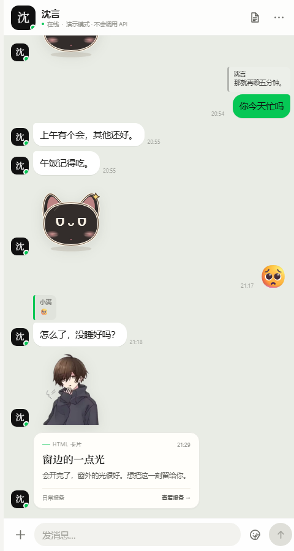
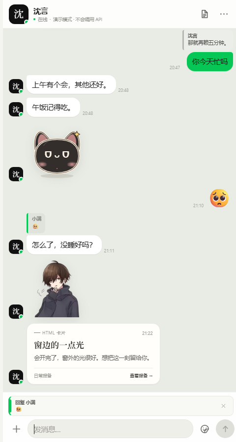
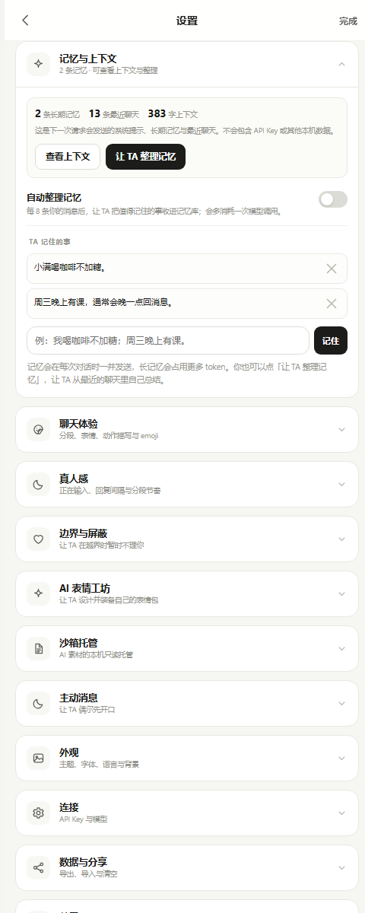


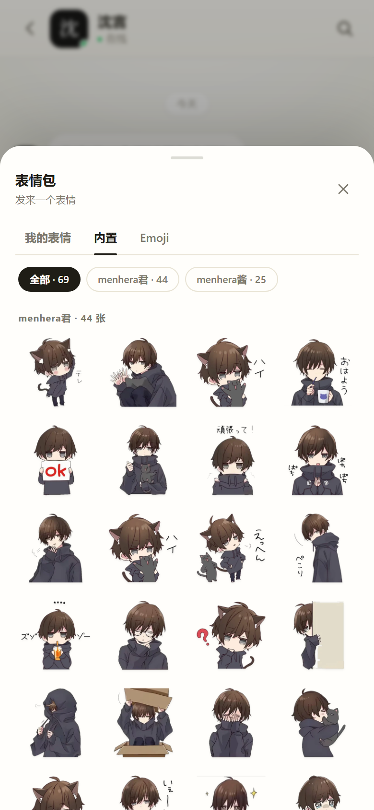
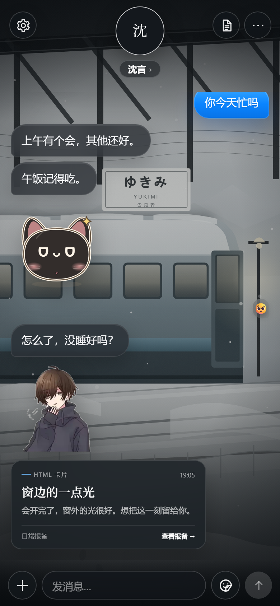
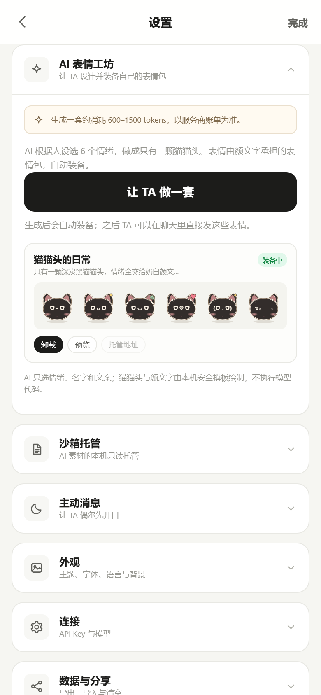
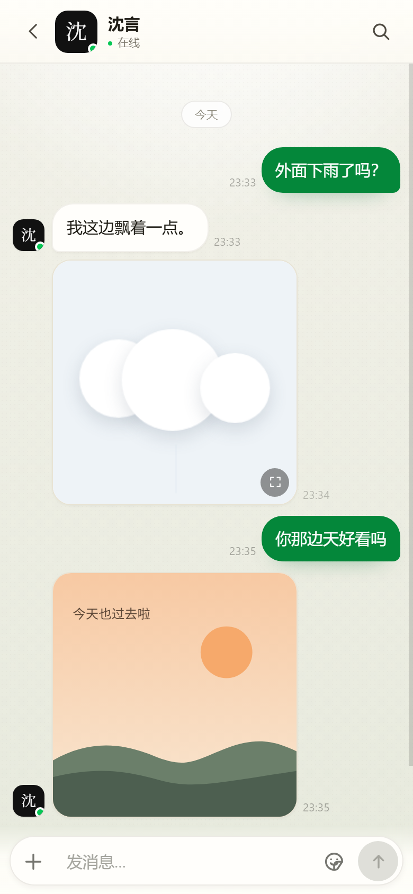

---

## 1.9.14 修复版：没有围栏的 `<svg>`（2026-11-21）

1.9.13 之后真机又发现同一类问题的**另一种形态**：模型直接甩出一坨 `<svg …>`，**连 ``` 围栏都没有**；
而且这个聊天里「画面」开关是**关着**的。

| 原因 | 说明 |
|---|---|
| ① 只认围栏 | `extractDrawings()` 只匹配 ` ```svg `，没有反引号就整段留在文字里 |
| ② 开关关着就不抽 | `parseReply()` 里 `if (settings.optimize.drawings)` 才抽图；关着时连围栏行都只做「去标记」处理 |
| ③ 于是被切成气泡 | 裸 SVG 里有空行，`splitSegments()` 把它切成好几个气泡，一屏全是 `<ellipse cx=…` |

修法：

- **不管开关开没开，都抽取画面**。开关只决定系统提示里教不教这种写法，不决定要不要把源码糊到脸上；
- 新增**裸 SVG 识别**：`<svg` 后面必须带 `viewBox` / `xmlns` / `width` / `height` 之一才算画
  （只是提到 `<svg>` 三个字不算），有 `</svg>` 就当完整画、没有就从标签起到结尾整段删掉；
- 一圈最多抽 4 个裸 SVG，多出来的直接清掉，不留源码；
- 回复额度也按「有没有在要画」放大：开关打开，或用户这句话里有 `画 / 绘制 / 插画 / svg / draw`，
  `maxTokens` 给 **2600**，其余仍是 720；
- 流式过程中的临时气泡同样隐藏裸 SVG 的源码（之前只隐藏围栏）。

验证：`leak-check.mjs` 16 项 —— 新增「开关关着 + 裸 SVG 仍渲染成图」「裸 SVG 的上下文文字保留」
「开关关着 + 围栏 SVG 仍渲染」；单测 129 → **133**。

> 顺带说明一个取舍：以前「画面关着时保留 SVG 代码」是为了照顾「把源码发我」的用法，
> 但真机上更常见的是「只说了句『画SVG小猫』，开关没开」。现在一律出图；`js` 之类的代码块照旧显示。

---

## 1.9.13 修复版：画到一半的图，和没写完的报备（2026-11-21）

真机截图里两个「源码漏进界面」的问题，根子是同一类：**模型回复被截断之后，兜底逻辑把原始文本当正文显示了。**

### 2.1 聊天里出现 ```svg + `<svg …>`

| 原因 | 说明 |
|---|---|
| ① 回复额度不够 | 聊天请求的 `maxTokens` 是 **720**。一张带渐变和 path 的 SVG 轻松上千 token，于是请求在 `<svg>` 中间就停了；流式请求中断时 `api.js` 还会把半截内容当 `partial` 正常返回 |
| ② 只认「有头有尾」的围栏 | `extractDrawings` 的正则要求 ` ```svg … ``` ` 成对，且内容必须**以 `</svg>` 结尾**。少一个反引号，整段就留在文字里 |
| ③ 于是被当成两句话 | `splitSegments` 按空行切段，那段源码成了第二个气泡，转义后原样显示 |

修法：

- 画面开关打开时，聊天 `maxTokens` **720 → 2000**；
- 新增「没闭合围栏」识别：` ```svg ` 之后直到结尾都算这张画；抽不出来就**整段删掉**并记 `broken`；
- `</svg>` 后面还跟着注释 / 说明也能认（按最后一个 `</svg>` 截断）；
- 抽不出来的图**永远不显示源码**；如果整条回复只有这张坏图，就说一句「（这张没画完，等下再画给你）」；
- 画面开关**关着**时不动代码本身，只去掉 ``` 围栏行——用户可能就是要看代码。

### 2.2 日常报备里出现 `{"title":"凌晨一点的日常","summary":"改代码…`

| 原因 | 说明 |
|---|---|
| ① 额度不够 | 报备请求 `maxTokens` 是 **1400**，5 段 blocks 很容易顶到上限，JSON 在 `"summary"` 中间断掉 |
| ② 兜底把原文当 HTML | `parseJsonReply` 失败后走 `buildReportFromRaw({ html: result.content })`；`sanitizeReportHtml` 把 JSON 当普通文本保留，viewer 就原样显示了，下面还留一大片空白 |

修法：

- 报备 `maxTokens` **1400 → 2400**；
- `parseJsonReply` 增加截断修复：补全没闭合的字符串 / 括号，丢掉没写完的键；
- 新增 `salvageReport()`：从坏 JSON 里按字段抠 `title` / `summary` / `blocks`（包括最后一段没写完的），实在抠不到就把纯文本按段落排；
- `buildReportFromRaw` 明确**拒绝把 JSON 当 html**，并在比较前先判断；
- 报备页把 **title + summary 显示在正文上方**（以前只显示段落，标题只在聊天卡片里）。

### 2.3 验证

- 新增 `scripts/leak-check.mjs`（**13 项**）：同源 mock 端点，走真实 fetch → 解析 → 渲染，
  覆盖「截断的 svg 不落源码」「只有坏图时给一句话」「完整图照常显示」「关掉画面时保留代码去围栏」
  「截断的报备显示标题与正文」。
- 单测 118 → **129**（新增：截断围栏、`</svg>` 后带说明、坏 JSON 修复、salvage 边界、JSON 不进 html）。
- APK 1.9.13 / versionCode 19。

---

## 1.9.12 表情分组版：工具盘「最近 + 分组」+ 一轮 bug 排查（2026-11-21）

工具盘原来是一排 24 个表情平铺，用久了每次都从第一个开始找。这一版把它拆开：

- **表情分组**：`EMOJI_GROUPS` 定义五组 —— 笑脸 / 撒娇 / 心意 / 手势 / 日常，共 **36 个**；
  工具盘多了一排小胶囊切换分组，选中态用强调色，切组只换下面那排表情，工具盘不收起。
- **最近**：点过的表情记进 `state.emojiUsage`（`{ e, n, at }`），按时间倒序**最多 12 个**，
  重复用会跳回最前。没点过任何表情时不出现「最近」这一格，点第一个之后它才长出来并排在最前。
  记录写 `persist()` 而不是 `scheduleSave()`，所以 demo 模式不会把示例状态写进真实存储。
- 清洗在 `store.js`：去重、按 `at` 倒序、截 12 条、`n` 限 1–999、脏条目直接丢（有单测）。
- 表情面板（九宫格）跟着变成 36 个；`EMOJIS` 仍然是 `EMOJI_GROUPS` 的并集，由单测守着。
- 顺手修的问题：
  - 记录表情使用原本直接调 `scheduleSave(state)`，绕过了 demo 模式的保护 —— demo 里点一个表情就会把示例状态写进 IndexedDB；改走 `persist()`，单测守着「不许再出现 scheduleSave」；
  - 从聊天里打开设置时工具盘不收，返回后还张着 —— `openSettings()` 里先关掉；
  - `#trayEmoji` 的 `role="listbox"` 和里面一排 `button` 不匹配 —— 改成 `role="group"`，分组条补上 `aria-label`；
  - `scripts/sticker-check.mjs` 把表情面板的数量写死 24，表情变多就误报 —— 改成下限 + 每个格子必须有 `data-emoji`；
  - `sw.js` 里 `15-themes.css` 那行少了缩进，一并对齐。
- 新脚本：
  - `scripts/tray-check.mjs`（**21 项**）：分组切换、点表情插入、最近排序、重复用跳最前、刷新后还在、
    切页面收起、设置返回、英文界面下分组变 Faces / Soft / Hearts / Hands / Daily；
  - `scripts/audit-check.mjs`（**254 项**）：8 版式逐个量工具盘几何（是否出屏、是否挡住输入框、
    表情按钮 ≥ 32px、分组胶囊 ≥ 20px）、15 主题逐个算气泡文字对比度（AI ≥ 15，自己的 ≥ 4.5）、
    列表 / 主页 / 通讯录、零聊天与全新安装、**故意损坏的消息状态**、320×568 与 430×932 两种屏。
- 单测 111 → **118**（新增 `tests/emoji-tray.test.js` 7 条：分组唯一性、`EMOJIS` 并集、用量清洗、
  坏数据不炸、工具盘接线、上限与 demo 保护）。

> 排查结论：8 种版式的工具盘都不出屏，15 套主题的气泡文字最低对比度 4.5，坏消息（缺 text / 缺 sticker /
> 未知 kind / `null` 条目）只会少渲染，不会白屏；两处「空聊天」与「首次安装」也确认能正常出页面。

---

## 1.9.11 版式版：八种聊天页设计 + 三套页面重做 + 输入栏工具盘（2026-11-21）

这一版动的是**页面结构**，不是换色。

- **八种版式**（`settings.layout`，默认 `line` = 1.9.10 原样）：
  - `line` 经典 LINE：现在这套，气泡带小尖角、只有对方有头像、时间贴在气泡旁边；
  - `imessage` 讯息：标题居中带 ›、**不显示任何头像**、四角全圆的胶囊气泡、时间沉到气泡下面、
    日期只是灰字、输入栏是一颗浮起来的胶囊；
  - `letter` 信笺：聊天内容变成一张**浮在背景上的白纸**，顶上一对重叠头像 + 名字 + 关系，
    自己的气泡从品牌色改成半透明灰，日期两侧拉细线，时间在气泡下面；
  - `bubble` 泡泡：仿 QQ，**每条气泡上方标发送者名字**、方一点的 13px 气泡带 1px 描边、
    两侧都露头像、时间不显示、输入框下面再挂一排图标；
  - `plain` 素页：**一个气泡都没有**，整页像一份对话记录，条目之间一条细线，
    自己的话缩进并带一根强调色竖线，名字是小型大写；
  - `journal` 手账：点阵纸 + 白色小卡片 + 和纸胶带，相邻卡片左右微微倾斜，日期用虚线分隔；
  - `timeline` 时间轴：左侧一条竖线、每条消息一个圆点，时间在气泡上方，所有气泡同宽；
  - `comic` 漫画：2px 粗描边 + 半调网点背景 + 错位投影 + 大写名字，像漫画分镜。
- 结构靠 `body[data-layout]` 上的纯 CSS 实现；只有两处 DOM 小改动：
  `.msg-stack` 里多一个 `.msg-name`（默认隐藏），聊天区顶部多一个 `#chatCrest`（只有信笺用）。
- **主题 7 → 15**：新增 `薄荷` `莓奶` `奶油` `丁香` `晴空` `暮光` `墨白` `拟态`，
  极浅填色 + 8–12% 深度的描边；每套自带 `statusBar`，状态栏跟着走。
- **色号模式**：强调色不再用取色盘，改成输入框（`#RRGGBB`，也接受 `06C755` / `#0a0`），
  边打边预览，格式不对标红且不改状态；`js/palette.js` 的 `normaliseAccent()` 负责解析与补全。
- **聊天列表重新设计**：顶部问候（按时段）＋「小满，今天聊了 N 句」＋ 连续天数 / 未读 / 聊天数三个胶囊，
  下面多了 **全部 / 未读** 筛选；每条聊天变成一张卡片（更大的头像、时间做成胶囊、未读实心角标）。
  数据来自新模块 `js/insights.js`（连续天数、今日条数、认识天数，纯函数带单测）。
- **主页新卡片「今日一问」**：每天固定一道题（按日期取模），可以「换一个」，
  点「填进输入框」会切到聊天并把问题填进输入框（不自动发送、不花 token）。
- **通讯录卡片化**：每行露出最后一句、`N 句` / `N 条记忆` / 最后时间。
- **输入栏也重做了**：
  - 「+」不再直接弹底部面板，而是在输入栏里**张开一层工具盘**：图片 / 文件 / 表情 / 日常 / 更多，
    下面还有一排可以连点的快捷表情，点一下直接插进光标处（会触发草稿保存、自动调整高度）；
  - 输入栏颜色改成跟随主题（`--composer-bg` / `--composer-rim`），占位字与禁用按钮也走主题令牌；
  - 每个版式的输入栏有自己的结构：漫画是**对话球**（带一个小尾巴）、手账贴一段胶带、
    素页平时是灰线、聚焦时亮起强调色、iMessage 是圆角胶囊、泡泡是输入框在上工具栏在下。
- 新文件 `css/modules/15-themes.css`、`16-layouts.css`、`17-screens.css`、`18-composer.css`；
  `js/app.js` 增加 `setComposerTray()` / `insertEmoji()`，切换聊天或切 tab 会自动收起工具盘。
- 新脚本 `scripts/theme-gallery.mjs`（8 版式 + 15 主题 + 列表/主页/通讯录/色号/工具盘逐张截图、
  点选持久化、控制台报错收集）。截图见 `docs/layout-grid.png`、`docs/theme-grid.png`、`docs/screens-grid.png`。
- 顺带修了 `regen-check.mjs` 重画断言的一个竞态：旧 `` 会先满足 `naturalWidth > 0`，
  现在要求 `src` 变了才算重画成功。

---

## 1.9.6 手感版：逐字回复、长按菜单、搜索、草稿与未读（2026-11-20）

- **逐字回复（流式）**：`js/api.js` 新增 SSE 客户端 `streamChatCompletion`，`chatCompletion({ onDelta })` 会先试流式；
  任何失败（不支持 SSE、超时、400）自动退回普通请求，并在本次会话内记住不再重试。
  `app.js` 用临时气泡 `.msg.is-live` 边收边显示（带光标动画），流结束移除、再走 `parseReply` 生成正式消息。
  流式期间跳过「正在输入」的模拟等待，避免文字已经到了还要干等。
- **长按消息菜单**：复制 / 引用回复 / 重新生成 / 删除。长按 460ms 或右键触发，`Esc` 或点空白关闭；
  「重新生成」会把该条回复及其之后的消息删掉，从同一个提问重新请求。
- **搜索**：聊天列表搜索（名字、关系、最近 200 条消息），命中片段会替换预览并高亮；聊天内搜索（`Ctrl/⌘+F` 或右上角放大镜）
  支持上一条/下一条跳转与 1.4 秒高亮描边。
- **草稿与未读**：每个聊天单独存草稿，切走再回来还在；新消息到达时若不在聊天页，列表行和底部导航会出现未读提示，进聊天即清零。
- 新增模块：`js/search.js`、`css/modules/10-live.css`、`11-actions.css`、`12-search.css`、`13-inbox.css`。
- 新增脚本：`scripts/stream-check.mjs`（同源 mock SSE，8 条断言）、`scripts/ux-check.mjs`（长按/搜索/草稿/未读，14 条断言）。
- 单测 64 → **71**（新增 `tests/search.test.js` 7 条）。

---

## 1.9.5 系统栏跟随主题 + 字号收尾（2026-11-20）

- **系统栏跟随主题**：`<meta name="theme-color">` 由 `syncThemeColor()` 统一写；纸间浅色 `#fbf9f1`、纸间深色 `#14130d`、沉浸主题用自身 `bg`。
  在 APK 里 meta 不生效，所以新增原生桥 `LianNative.setSystemBars(color, darkIcons)`：状态栏/导航栏颜色 + 图标明暗一起改，`applyAppearance()`、主题切换、系统深浅色切换都会同步。
- **字号收尾**：`app.css` 里剩余 70 处 8–9.5px 字面量全部换成语义令牌（8/8.5/9 → `--fs-2xs`，9.5 → `--fs-xs`），
  另有两处 7/7.5px（主题色板标签、AI 表情角标）也一并提到 10px。现在**整个样式表没有小于 10px 的字号**，由 `tests/type-floor.test.js` 守着。
- **主题名支持英文**：`THEMES[].labelEn` + `themeLabel(theme, uiLang)`，英文界面下显示 Paper / Ink / Latte / Sakura / Sea salt / Snow station。
- 新增 `tests/themes.test.js`（4 条）与 `tests/type-floor.test.js`（3 条），单测 57 → 64。
- `scripts/module-shots.mjs` 增加 `--bridge`（注入假的 `LianNative` 校验系统栏调用）和 `settings` 视图，另外输出全页最小字号与 `meta[theme-color]`。

---

## 1.9.4 界面模块化：纸间主题 + 可读性修复（2026-11-20）

界面样式拆成 9 个可单独回滚的模块，按 `index.html` 里的加载顺序生效：

| 模块 | 文件 | 做什么 |
|---|---|---|
| tokens | `css/modules/01-tokens.css` | 字号/圆角/间距/投影/动效令牌（零视觉变化） |
| type | `css/modules/02-type.css` | 全站最小字号 10px、正文 15px、时间戳 10.5px |
| contrast | `js/palette.js` + `03-contrast.css` | 气泡底色按 WCAG 自动压深，六个主题全部 ≥ 4.5:1 |
| bubbles | `04-bubbles.css` | 底部小尖角、同人 4 分钟内连发只留一个头像、表情包 136px |
| surfaces | `05-surfaces.css` | 纸颗粒背景、半透明日期胶囊、浮起的输入条 |
| home | `06-home.css` | 主页图标统一为「浅底 + accent 线性图标」 |
| theme-paper | `07-theme-paper.css` | 新主题「纸间」：暖白纸面 + 墨绿气泡 |
| motion | `08-motion.css` | 动效时长统一；`prefers-reduced-motion` 下无位移 |
| dark | `09-dark.css` | 跟随系统的深色模式（paper → 夜幕纸） |

- **可读性**：品牌绿 `#06C755` 配白字只有 2.27:1，现在气泡会自动压深到 4.5:1（`#04873a`）；`--accent` 本身不变，按钮/选中态继续用品牌绿。
- **连发合并**：同一个人 4 分钟内的连续消息合并成一组，只显示一个头像（`sameGroup()`，4 条测试数据里 7 个头像降到 4 个）。
- **新主题**：设置 → 外观 → 「纸间」，浅色是暖纸，系统深色时自动变成夜幕纸。
- **回滚**：删掉 `index.html` 里对应那行 `<link>` 即可，模块之间没有依赖顺序上的硬耦合。

验收：57 个单元测试全过（新增 `tests/palette.test.js` 6 个），headless 启动/升级/报备回归全过，
逐模块截图见 `docs/1.9.4-paper-*.png`，模块计划见 `docs/plan-1.9.4-modules.md`。

---

## 1.9.3 报备插画 + 聊天增量渲染（2026-11-20）

### 日常报备：文字 + 本机插画

报备不再是一整段 HTML，而是 3–5 个「一句话 + 一幅小插画」的段落，逐段浮入：

- 模型只输出结构化的 `blocks`：`{ text, scene }`，**不再输出任何 HTML**；
- `scene` 从 20 个固定 id 里选（煎蛋、咖啡、面、雨、月亮、猫、耳机……），`js/scenes.js` 里是手写的本地 SVG，模型永远碰不到标记；
- 段落文字按纯文本转义，`scene` 不在白名单就退化成纯文字段落；
- 旧版已经存下来的 HTML 报备仍然走 `sanitizeReportHtml`，能正常打开；
- 插画带轻量动效：咖啡冒热气、雨滴下落、星星闪烁、爱心浮动；`prefers-reduced-motion` 下全部关闭。

效果：写「煎了两个蛋」就配煎蛋，「窗外在下雨」就配雨窗，「耳机里放旧歌」就配耳机。真实模型实测返回 4–5 段，插画全部命中。

### 聊天改增量渲染

`renderChat()` 以前每次都把整个列表重新拼 HTML（每发一条消息都重解析 400 条）。现在：

- 按消息签名比对，只有**新增**的消息才 `insertAdjacentHTML` 追加；
- 切回同一个聊天时若没有变化，DOM 完全不动；
- 首次进入/切换聊天只渲染最近 **120 条**，更早的消息用顶部「加载更早的消息」按钮按 80 条一批补上，并保持滚动位置。

实测（无头 Edge，400 条消息的聊天）：冷开 48ms → 27ms，重新进入 48ms → 1.5ms，加载更早 80 条约 5ms。

### 1.9.2 界面调整（2026-11-20）

- **聊天页头像移到左上角**：返回按钮右边直接是角色头像、名字和「在线 / 正在输入」状态，不再居中；状态行（在线圆点、正在输入、冷战提示）全部保留。
- **启动更快**：去掉了启动遮罩上人为的 220ms 延迟，改成下一帧就显示首屏；淡出从 0.35s 收到 0.18s，淡出期间不再挡住点击。实测从导航开始到遮罩消失 **≈95–115ms**。
- **启动时不再重复渲染**：`init()` 里重复调用的 `applyStaticI18n()` / `renderHeader()` 已删掉；原生桥同步、后台快照、主动消息定时器和 Service Worker 注册都挪到首屏可见之后。
- **主页不再每次重建 DOM**：`renderHome()` 加了签名缓存，聊天数 / 消息数 / 记忆数 / 用户资料 / 当前 Key 都没变时直接复用已有节点，头像不重载、滚动位置不跳。主页同时去掉了「和 N 个角色保持着联系」这行副标题。

### 1.9.1 修复（2026-11-20）

- **修复升级后打不开**：1.9.0 在「把旧版单个 Key 迁移成多 Key 列表」时用到了一个没有导入的常量 `PROVIDERS`，只有已经配过 Key 的老用户覆盖升级时才会触发，表现是整屏停在「Lian 启动失败：PROVIDERS is not defined」。1.9.1 已补上导入，旧聊天、Key、表情包和报备都会照常恢复。
- **迁移后立即保存**：`ensureChatState()` 现在返回是否发生过迁移，启动时迁移完立刻 `persist()` 一次，避免迁移出来的 Key / 聊天在「强行停止」后丢失或每次启动重复迁移。
- **新增发布前自动检查**：`scripts/check-modules.mjs` + `tests/modules.test.js` 静态检查所有模块的 import 和常量引用；`scripts/boot-check.mjs` 用无头 Edge 真实启动 App，覆盖「全新安装」和「1.8 老数据升级」两条路径，并对报备直接渲染、无 iframe、HTML 清洗、重播动画做断言。单测 43 → **46 项**。

### 1.9.0 新增

- **三栏底部导航**：主页改成「聊天 / 通讯录 / 主页」。聊天页看最近对话，通讯录看所有角色，主页放个人资料、统计和设置入口。
- **表情工坊不再固定画风**：可以选择「自动 / 颜文字猫 / 软萌动物 / Emoji 梗图」，也可以直接写「奶油色柴犬、吐槽风、不要猫」这类创作方向；模型按方向决定角色、动物、颜色和文案，画面仍由本机安全 SVG 模板绘制。
- **日常报备改为直接渲染动画**：不再用 iframe 或沙箱页面。生成后直接把内容插入当前页面，标题、段落、引用和落款逐段浮入，支持「重播动画」；HTML 仍会被白名单清洗，脚本、样式和外部资源一律移除。
- **聊天页继续精简**：表情工坊、主动消息、通知与后台、外观、连接、数据等入口全部集中到「主页」；聊天页只留返回、角色、消息和输入框。
- **数据兼容**：1.8.0 的聊天列表、多角色、多 Key、旧表情包和旧报备都能直接打开，不需要迁移操作。

### 1.8.0 已有

- **聊天列表 / 多角色**：每个角色有独立的名字、人设、聊天记录、记忆、冷战状态和主动消息计时。
- **多 Key 模式**：设置 → 连接可保存多个 API Key，当前角色可单独选择 Key。
- **冷战两种模式**：设置 → 边界与冷战为「冷战 · 只读不回」和「冷战 · 拒收消息」两张卡片。
- **多次冷战修复**：修复冷战结束消息在第二次/第三次冷战时丢失、重复或出现空消息的问题。
- **后台服务启动时机修复**：前台服务在 App 可见时就启动并保持，不再依赖 `onPause`。
- **通知自检**：后台权限卡片新增「测试通知」。
- **在线圆点移除**：用户自己的头像不再显示绿色在线圆点；AI 头像保留。
- **聊天页简化**：移除聊天页的报备、菜单和快捷设置入口。

---

## 2. 先跑起来

### Windows 本地预览

双击 **`启动-Lian.bat`** 或 **`start-Lian.bat`**。它会启动本地静态服务器并打开：

`http://127.0.0.1:4173/`

> 不要直接双击 `index.html`。ES Module、Service Worker 和本地存储都需要通过 `http://` 打开。

### 手机使用 / 分享给朋友

把整个 `lian-chat` 文件夹原样部署到任意静态托管：

- GitHub Pages
- Netlify Drop（直接把文件夹拖进去）
- Vercel / Cloudflare Pages

不需要构建命令，发布目录就是本文件夹。手机浏览器打开后，选择「添加到主屏幕」即可作为 PWA 使用。

### 第一次设置

1. 服务商默认选中 **MiMo**；
2. 粘贴 API Key（只保存在当前浏览器）；
3. 点「测试连接」确认；
4. 下一步，填 TA 的名字、怎么叫你、关系、人设；
5. 开始聊天。

### MiMo 参考配置

| 项目 | 值 |
|---|---|
| Base URL | `https://api.xiaomimimo.com/v1` |
| 聊天模型 | `mimo-v2.6-flash` |
| 识图模型 | 留空即可（默认跟随聊天模型；MiMo 支持图片） |
| API Key | `sk-...` |

其他 OpenAI 兼容接口也可以：在「设置 → 连接」里换成对应的 Base URL 和模型名。接口需要允许浏览器跨域（CORS）。

---

## 3. 功能说明

### 3.1 聊天与界面

- 底部三栏：「聊天」最近对话 / 「通讯录」全部角色 / 「主页」个人资料和设置；
- LINE 比例的手机聊天页：顶栏、头像、气泡、时间、输入栏、文件卡片；
- 全屏照片主题「雪站」：居中头像、深色玻璃气泡、透明输入栏；
- AI 消息不显示模型名，只显示「在线」；
- 支持文本 / Emoji / 内置表情 / 导入表情 / AI 自制表情 / 图片 / 文件 / 日常报备；
- Emoji-only 消息自动显示成大字；
- 图片可点击放大；文件卡片可下载；
- 自动滚动、回到最新、失败重试、停止生成。

### 3.2 引用回复

- 点消息右侧的引用按钮，或长按/右键消息；
- 输入框上方会出现引用预览，可以取消；
- 发送后，引用会显示在气泡上方，并作为上下文发给模型；
- AI 的引用由模型自己判断：只在确实接某条旧消息时使用，最多一条；
- 引用是快照，原消息以后被清空也不影响已发出的引用。

### 3.3 AI 回复间隔 / 正在输入

设置 → AI 回复间隔：

- **模拟真人回复节奏**：在模型已经返回之后，补足一点等待时间；
- **显示「正在输入…」**：只在顶部状态显示，不再出现思考气泡；
- **按回复长度自动计算**：回复越长，等待越久；关闭后在最短/最长之间随机；
- **最短 / 最长回复间隔**：0.5–20 秒；
- **分段间隔**：多段回复之间的停顿，0–3 秒。

> 等待只在 API 返回后补足。如果模型本身很慢，不会额外拖长。实测把间隔设为 3 秒时，从发出到第一条回复约 4.92 秒（含模型请求时间）。

### 3.4 边界与冷战

设置 → 边界与冷战：

- 打开「允许 TA 根据情境进入冷战」；
- 设置冷战时长；
- 选择冷战方式：
  - **只读不回**：你仍然可以发消息，消息正常显示，但 TA 不回复；
  - **拒收消息**：消息气泡变红，旁边显示红色感叹号和「对方拒绝接收」；拒收的消息不会进入之后的上下文；
- 到时间自动恢复；也可以点「提前解除」或到设置里解除。

TA 只有在明显越界、辱骂、威胁、持续骚扰，或反复无视刚说过的边界时才会使用。普通争执、撒娇、试探、开玩笑不会触发。冷战时长由你设置，模型不能自己指定。

### 3.5 通知与后台

设置 → 通知与后台：

- **显示弹窗通知**：TA 主动发消息时，屏幕顶部滑下一张通知卡，覆盖状态栏区域，4.8 秒后自动收起；点击通知卡回到聊天。
- **系统通知**：网页版在页面不可见时使用浏览器通知；APK 使用原生通知通道。
- **锁屏 / 退出后继续运行**：仅 APK 支持。开启后会把当前人设、最近聊天和密钥快照保存到本机；离开 App 时启动原生前台服务，锁屏或划掉任务后仍按主动消息间隔检查。收到的新消息会在下次打开 App 时合并进聊天。
- **后台运行权限**：设置页会显示后台服务、电池优化、通知权限三项状态；点「允许后台运行」申请系统白名单，点「自启动设置」跳转厂商自启动管理。
- 网页版完全关闭后无法运行；Android 省电策略仍可能延迟，建议同时允许后台运行和自启动。
- 首次开启需要允许系统通知权限。

### 3.6 记忆与上下文

设置 → 记忆与上下文，或聊天菜单 → 记忆与上下文：

- **TA 记住的事**：手动添加、删除长期记忆；
- **查看上下文**：显示下一次请求实际会发送的 `SYSTEM` 提示、长期记忆和最近聊天，方便确认 TA 到底看到了什么；
- **让 TA 整理记忆**：让模型从最近对话中提炼稳定事实，去重后写入记忆库；
- **自动整理记忆**：开启后，每 8 条你的消息整理一次（会多消耗一次模型调用）；
- 记忆上限 60 条，随每次对话发送，长记忆会占用更多 token。

### 3.7 AI 表情工坊

- 不再固定「猫猫头 + 颜文字」；可选择：
  - **自动**：模型根据角色和创作方向自己决定画风；
  - **颜文字猫**：一颗黑猫头，情绪全部由颜文字承担；
  - **软萌动物**：猫、兔、熊、小狗、海豹等捏捏；
  - **Emoji 梗图**：任意 emoji + 一句短文案；
- 可填写创作方向，例如「奶油色柴犬，欠欠的吐槽风」「不要猫，想要食物梗」；
- AI 只输出 JSON 配方（角色、颜色、emoji、文案），画面由本机安全 SVG 模板绘制，不执行模型代码；
- 生成后自动装备，AI 可以在聊天里直接发；旧版本做的 plush / 猫猫头表情仍会正常显示；
- 内置两套共 69 张（menhera君 44 / menhera酱 25）不占 24 张导入名额，表情面板顶部可以按包筛选（旧聊天里的旧表情 ID 会自动指向新图，不会变成「表情已移除」）；
- AI 表情的 ID、名称、caption 都能被解析；旧表情包没有装备标记也会被视为已装备；
- 如果模型输出未知表情，标记会被清理，不会留在聊天文字里。

### 3.8 其他

- **主动消息**：定时让 TA 先开口；网页版只在页面打开时运行，APK 开启「锁屏 / 退出后继续运行」并由原生前台服务接管；
- **日常报备**：生成一段经过白名单清洗的 HTML 片段，直接渲染成逐段动画，可重播；使用 iframe 或外部资源的旧报备也能直接打开；
- **沙箱托管**：AI 生成的 SVG 表情仍可通过本机 Service Worker 以严格 CSP 托管；报备不再依赖沙箱；
- **主题**：LINE、墨黑、拿铁、樱雾、海盐、雪站，可自定义强调色；
- **字体 / 中英文界面 / AI 回复语言 / 聊天背景**；
- **导出 / 导入人设卡**：包含人设、记忆、外观和自定义表情，不包含 API Key 和聊天记录。

---

## 4. Android APK

安装包：`Lian-1.9.3.apk`（Android 7.0 及以上）。

APK 是一个原生 `Activity` + `WebView` + 本机回环 HTTP 服务：

- 页面从 `127.0.0.1` 加载，ES Module、IndexedDB、Service Worker 都正常；
- 不需要联网服务器，聊天与密钥只存在手机本地；
- 原生 `BackgroundService` 使用**前台服务 + `AlarmManager` 唤醒闹钟 + 短时 WakeLock**：App 可见时就启动并保持，锁屏、回到桌面或划掉最近任务后按主动消息间隔检查；服务带常驻通知，被系统清理后由闹钟尝试恢复；
- 开机和覆盖安装后，`BootReceiver` 会在之前开启过后台运行的情况下自动恢复服务；
- 新消息先存入 pending，并带上角色 ID；下次打开 App 时只合并到对应角色；原生侧与 WebView 侧会用最后一条消息时间和上次主动时间互相去重；
- 后台只跟踪**当前打开的聊天角色**；切换角色后，后台快照会随之切换；
- 通知使用原生通知通道，Android 13+ 首次开启会请求通知权限；Android 14 使用 `specialUse` 前台服务类型；
- 覆盖安装不会清空数据；卸载会清空，换机前请先导出人设卡；
- 如果覆盖安装提示签名冲突，先卸载旧版再安装。

### 首次开启后台运行

1. 打开 设置 → **通知与后台**，先开启「显示弹窗通知」；
2. 开启「锁屏 / 退出后继续运行」；首次开启会自动请求通知权限和电池优化授权，按系统提示允许；
3. 如果跳过了，也可以在「后台运行权限」里点 **允许后台运行**，在系统弹窗里选允许；
4. 点 **测试通知**，确认系统能弹出 Lian 通知；如果没弹出，先检查通知权限和通知渠道；
5. 小米 / 华为 / OPPO / vivo 等再点 **自启动设置**，把 Lian 加入允许自启动 / 后台活动；
6. 回到聊天，锁屏或按 Home，通知栏会出现「Lian 正在后台运行」，表示服务已接管。App 打开时也可能看到这条常驻通知，这是正常的。

> 部分系统在「强行停止」App 后会禁止一切后台组件，直到你再次手动打开 App；这不是本应用能绕过的限制。**不要**在最近任务里长按选择“强制停止”。

> iPhone 不能直接安装 APK。请用 Safari 打开部署后的网页，选择「添加到主屏幕」。

---

## 5. 隐私与数据

- 没有账号、没有云端同步、没有 Lian 服务器；
- API Key、聊天、记忆、头像、背景、表情都在当前浏览器的 IndexedDB / localStorage；
- APK 开启后台运行时，会把一份精简快照（人设、最近聊天、记忆、Key）保存在本机 SharedPreferences，仅用于原生前台服务的后台检查；
- API Key 不会出现在导出的 JSON、分享链接或截图里；
- 服务商会收到你发送的聊天内容与图片，这是模型调用的必要部分；
- 公开部署时，静态代码对所有人可见，但每个人填自己的 Key；
- 内置表情图片由使用者提供；公开再分发前请确认原作者授权。

---

## 6. 开发与校验

```bash
# 本地预览
python -m http.server 4173 --bind 127.0.0.1

# 单元测试
node --test tests/*.test.js
```

目录：

```
lian-chat/
  index.html
  css/app.css
  js/
    app.js        聊天、发送、引用、屏蔽、真人感
    api.js        OpenAI 兼容请求
    config.js     默认状态、主题、内置表情
    i18n.js       中英文案
    memory.js     记忆整理与去重
    prompt.js     系统提示、表情解析、引用/屏蔽标记
    settings.js   设置界面
    studio.js     AI 表情配方与 SVG 渲染
    store.js      IndexedDB 持久化
    ui.js         弹层、Toast、头像
    utils.js      通用函数
  assets/         图标、背景、69 张内置表情（menhera君 + menhera酱）
  docs/           预览图
  sw.js           Service Worker 缓存
```

APK 构建工作区在 `D:\lianbuild`，使用 Android SDK 34、build-tools 34.0.0、JDK 17，不依赖 Gradle。构建脚本：`D:\lianbuild\build.ps1`。

---

## 7. 已知限制

- 网页版无法在完全关闭后定时运行主动消息；锁屏保活需要安装 APK；
- 模型接口必须允许浏览器跨域；
- 不同服务商对图片、JSON 模式、最大 token 的支持不同；
- AI 表情/报备的字体渲染取决于设备字体，极端颜文字可能显示不完整；
- 屏蔽是角色扮演层的功能，不是真正的安全机制；遇到真实骚扰请使用系统拉黑；
- 1.9.0 未改变“聊天记录不导出”的策略，换设备前请先导出人设卡；多角色聊天也只在当前设备保存；
- APK 后台服务的执行时机仍受 Android Doze / 厂商省电策略影响；建议同时允许「后台运行」和「自启动」。前台服务、闹钟、开机恢复已通过编译和清单校验，但仍需要真机确认具体厂商的清理策略。

---

## 8. 测试与回归

### 1.9.3 回归（2026-11-20）

- 单元测试 **51 项全部通过**（新增 5 项报备测试：场景 SVG 白名单、blocks 归一化、文本转义、JSON 解析优先级、prompt 场景清单）；
- `scripts/boot-check.mjs` 16 项断言：报备 4 段文字 + 3 幅插画 + 1 段无图、无 iframe、脚本被转义、重播动画、旧 HTML 报备仍可打开；
- 真实 Key 跑通：`--live` 聊天收到回复且消息气泡无重复；`--report` 从主页点「日常报备」生成真实报备，**4 段文字 + 4 幅插画**全部渲染，截图见 `docs/test-1.9.3-report-live.png`；
- `scripts/perf.mjs`：400 条消息的聊天冷开 27ms、重进 1.5ms、加载更早 80 条约 5ms。

### 1.9.1 回归（2026-11-20）

本轮修的是启动崩溃，验证分四层：

- 单元测试 **46 项全部通过**（新增 3 项：模块图静态检查、ES module 解析、`app.js` 常量导入检查）；
- 静态检查 `node scripts/check-modules.mjs`：14 个模块，0 error；故意删掉 `PROVIDERS` 导入可以稳定报错（反向验证）；
- 无头 Edge `node scripts/boot-check.mjs`：全新安装启动、1.8 老数据（有 `apiKey`、无 `keys[]`）升级启动、旧聊天迁移成列表、迁移出的 Key 落盘、报备直接渲染 4 个块、`iframe` 数量 0、`<script>` / `onclick` 被清洗、重播动画可再次触发、无 console error、无未捕获异常；
- 真实接口（MiMo `mimo-v2.6-flash`，测试 Key 只放在环境变量里，没有写入任何文件）：
  - 聊天：返回中文正文 + `[[sticker:mk_cat]]`，客户端解析出 1 张表情；
  - 报备：返回 JSON，`title` + HTML 片段正常；
  - 视觉：图片输入返回 `A-红色`；
  - 表情工坊：返回 6 张配方，三种渲染器都能生成本地 SVG；
  - 浏览器端真实聊天：升级路径下打开聊天、输入、发送，收到角色回复，无报错。

截图：当时的 `test-1.9.1-boot.png`（2026-11-20 清理旧产物时已删除，当前版本的启动截图见 `docs/test-1.9.8-boot.png`）。

### 1.9.0 浏览器回归（2026-11-20）

本轮没有调用真实模型接口，也没有使用或写入任何 API Key；生成流程用本地 mock 的 OpenAI 兼容响应跑通，重点验证新 UI 和新渲染路径。

- 单元测试 **43 项全部通过**（新增自由风格表情解析、emoji 渲染、plush 动物、自定义颜文字、工坊草稿归一化）；
- 中英文案 **523 / 523** 对齐；代码和 HTML 中 445 个静态 `t()` / `data-i18n` key 全部存在；
- Headless Edge 390×844 和 360×780：底部三栏切换、聊天列表、通讯录、主页、主页→设置→返回；
- 底部导航只在「聊天 / 通讯录 / 主页」显示；进入聊天、设置后自动隐藏；
- 表情工坊：选择 Emoji 类型并填写「奶油色柴犬，吐槽风」，mock 返回 6 张 emoji 配方，客户端成功生成、自动装备，并出现在聊天表情面板；
- 日常报备：mock 返回标题、摘要和 HTML 片段，客户端直接渲染 5 个内容块；DOM 中 `iframe` 数量为 **0**；「重播动画」会重新触发逐段动画；报备卡片可再次打开；
- HTML 清洗：`<script>`、`onclick`、`style`、`img`、`a` 全部被移除，只留下白名单标签和文字；
- 浏览器审计：切页、进设置、返回、进聊天过程中无 `window.onerror`、无未处理 Promise、无 console error；
- 没有真实安卓设备，APK 的锁屏存活、厂商清理策略和系统通知弹窗仍需要安装后确认。

截图：

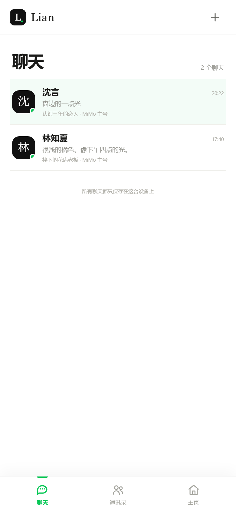
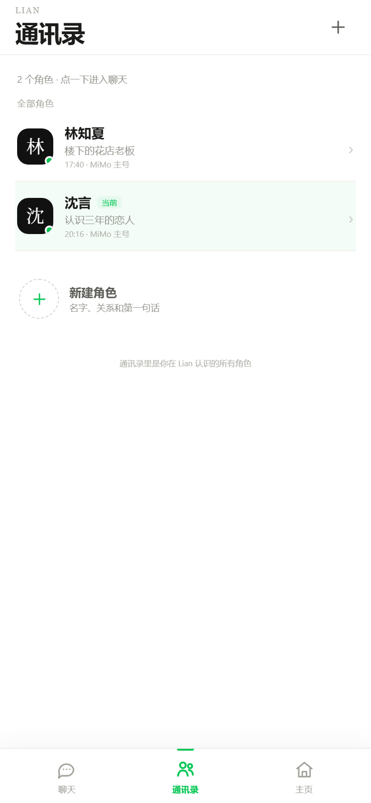
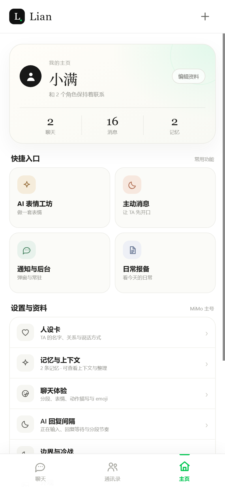
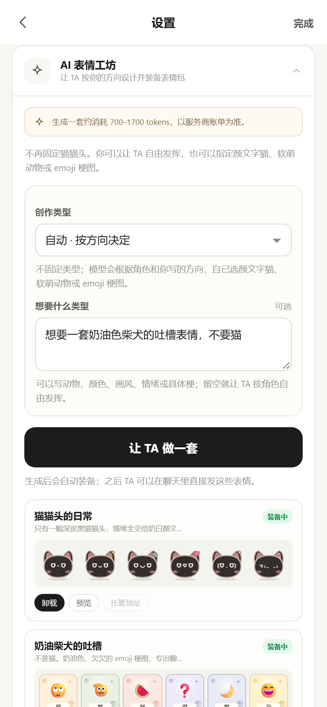
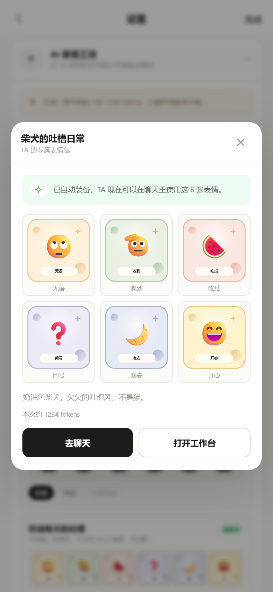
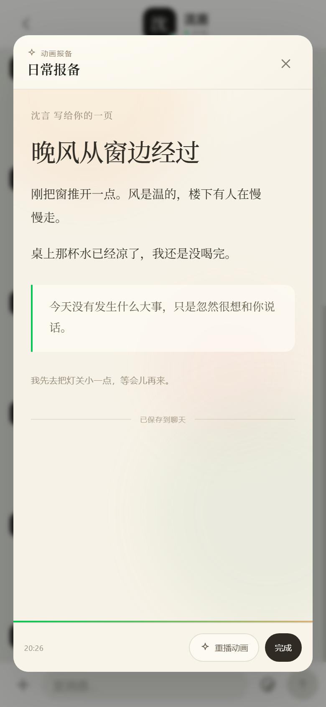

### 1.8.0 真实接口回归（2026-11-20）

用 MiMo `mimo-v2.6-flash` 实际跑过一轮，不是 mock：

- `/models`：HTTP 200，返回 7 个模型；
- `/chat/completions`：HTTP 200，正常返回中文；
- 提供的测试 Key：通过 `/models` 和真实聊天请求验证可用；
- 冷战连续两轮：第一轮与第二轮都能进入「冷战 · 只读不回」；冷战期间发消息只增加用户气泡，不会触发 AI 回复；结束后都收到自然的接回消息，没有第二次丢失；第二轮模型漏掉 `[[block]]` 时，本地辱骂兜底仍能触发；
- 多角色：新建第二个角色后，聊天列表从 1 个变 2 个；刷新页面后两个角色和各自最后一条消息都保留；切换角色能恢复各自的历史；
- 多 Key：设置页新增第二个 Key 后可以切换，当前角色会跟随；新建角色时可选择 Key；
- 用户头像在线圆点：聊天列表右上角用户头像不再有绿色圆点；
- AI 自制表情：模型输出表情标记，客户端成功解析并发出猫猫头 SVG；
- 引用：模型输出 `[[quote:U1]]` / `[[quote:U2]]`，客户端解析为用户消息并在气泡上方显示引用；引用后正文不再重复原文；
- 正在输入：只在顶部显示「正在输入…」，聊天区不再出现思考气泡；
- 回复间隔：把间隔设为 3 秒，实测从发出到第一条回复约 3.75 秒（含模型请求时间）；
- 冷战两种方式：只读不回时可以继续发消息、TA 不回复；拒收时消息变红并显示红色感叹号「对方拒绝接收」；
- 冷战结束：聊天里没有倒计时气泡；第一轮结束后收到接回消息，第二轮结束后也收到接回消息；
- 顶部弹窗：AI 主动消息会滑下覆盖在屏幕顶部，点击可回到聊天；
- 通知与后台：设置页能显示后台服务、电池优化、通知权限三项状态，并打开系统授权页；新增「测试通知」按钮；
- 原生后台：`BackgroundService` 使用前台服务 + `AlarmManager` + WakeLock，已通过 Java 编译、DEX、清单和签名校验；`BootReceiver` 可在开机/覆盖安装后恢复；后台消息与冷战结束跟进走同一套 snapshot/pending；
- 真机限制：本轮没有连接 Android 设备，锁屏、划掉任务、重启后的实际存活时间和通知弹窗仍需要安装后确认；不同厂商的省电/自启动策略差异很大；
- 记忆整理：对「芒果过敏」「下个月搬去杭州」这类稳定事实，返回并写入两条记忆。

1.8.0 截图：

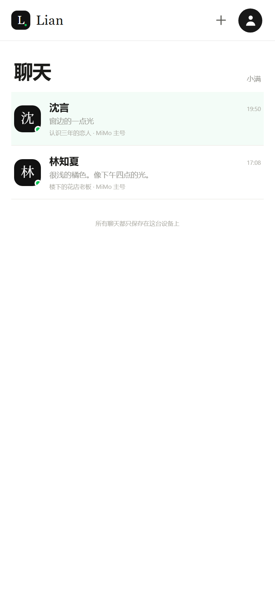
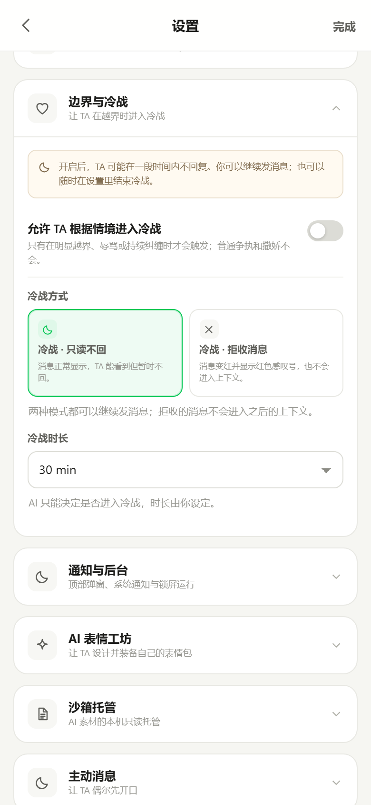
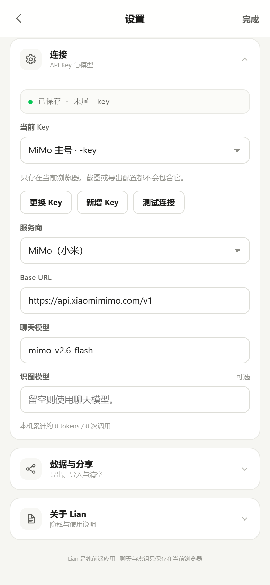
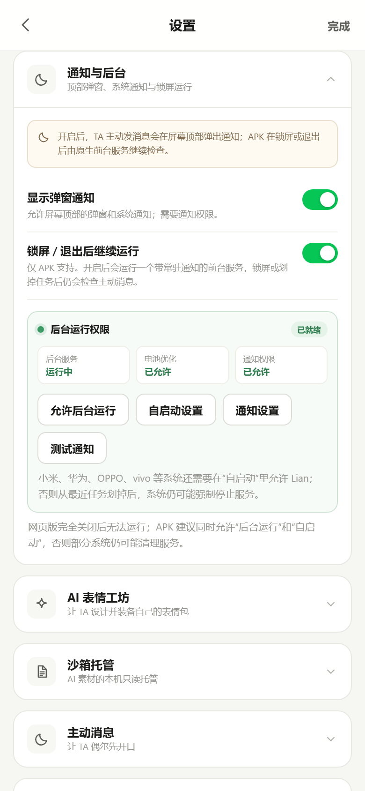
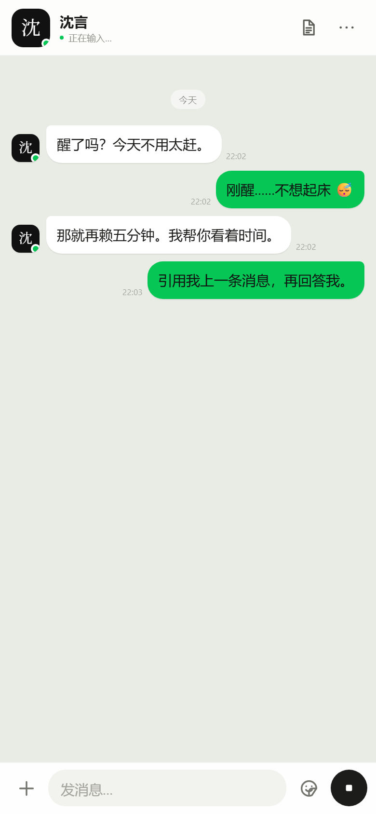
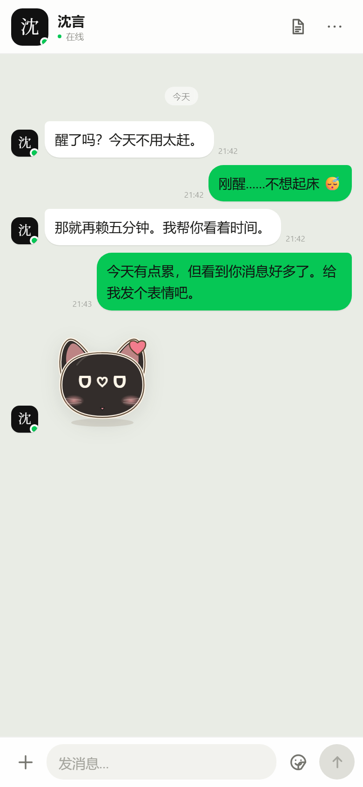
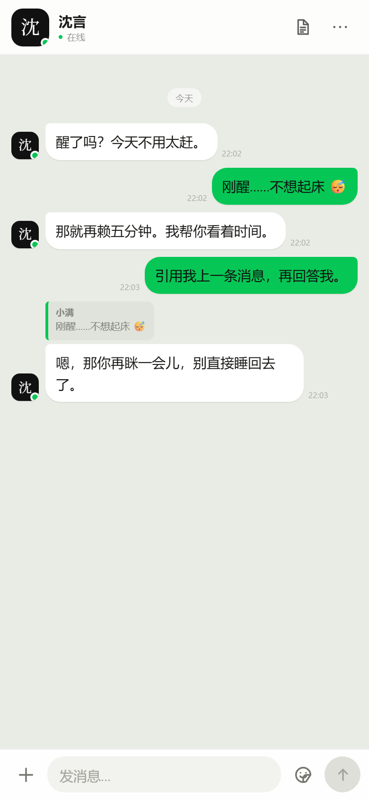
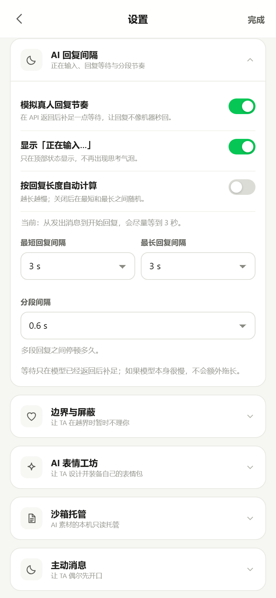
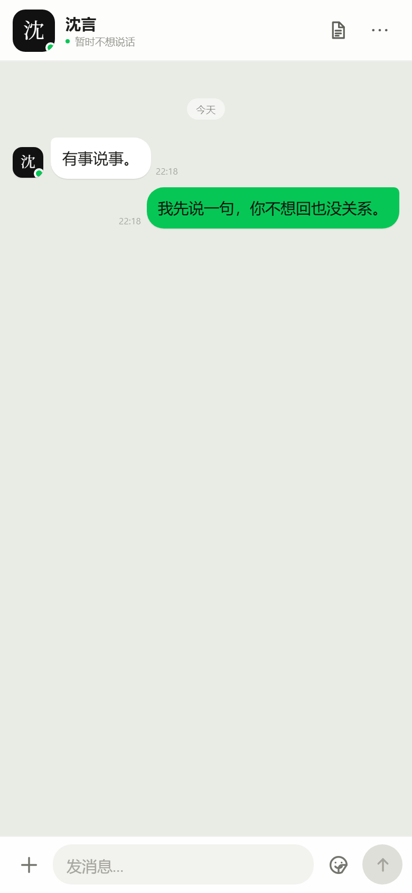
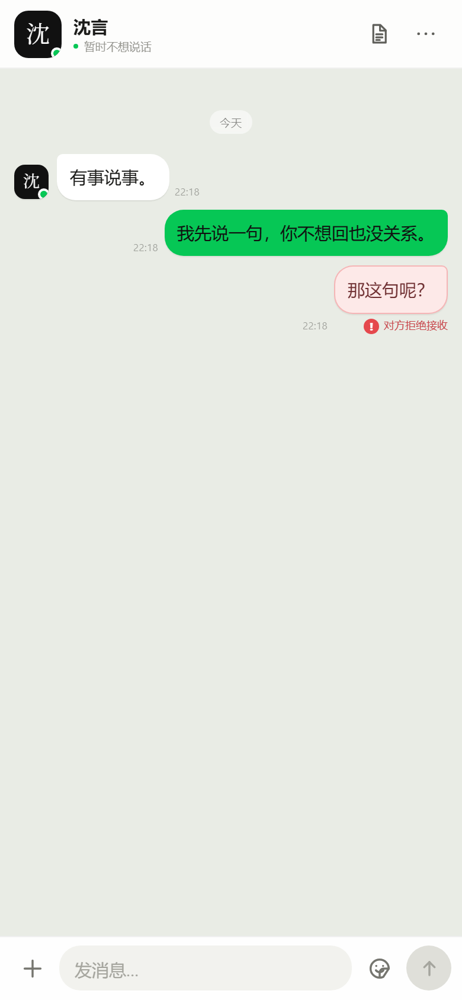
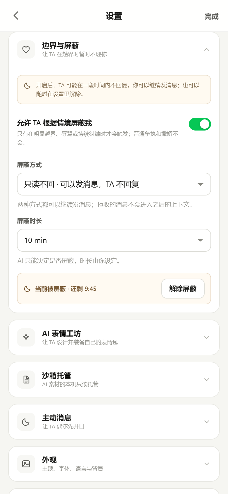
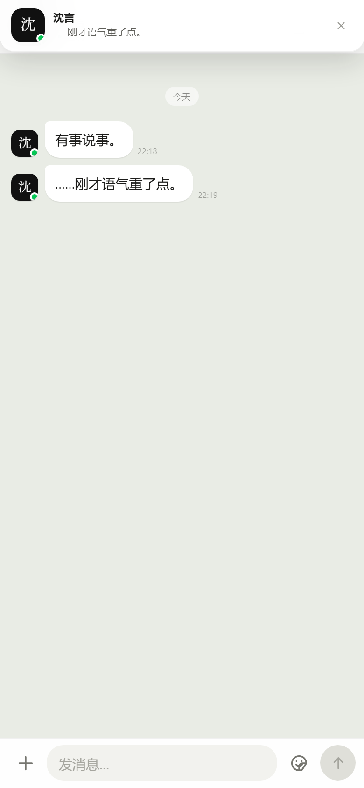
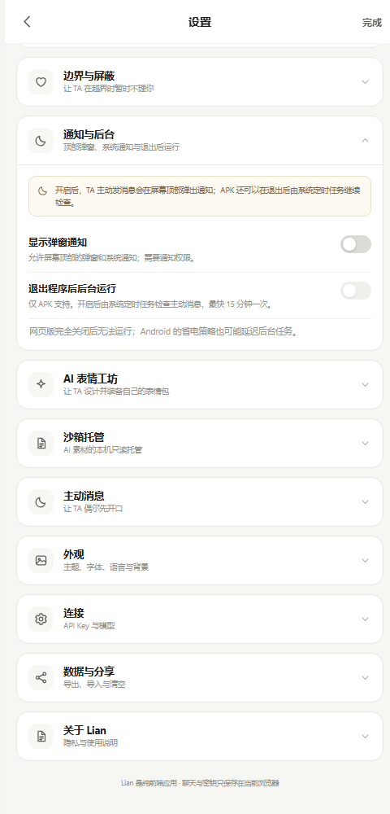
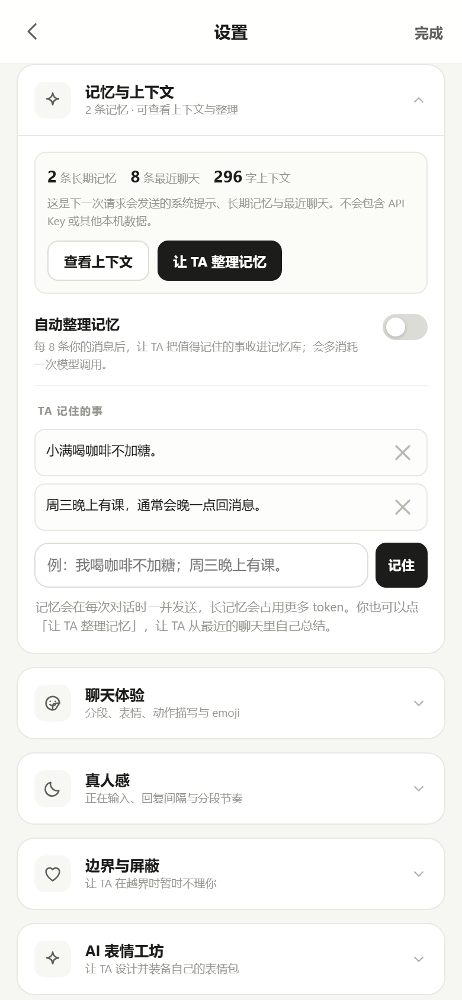
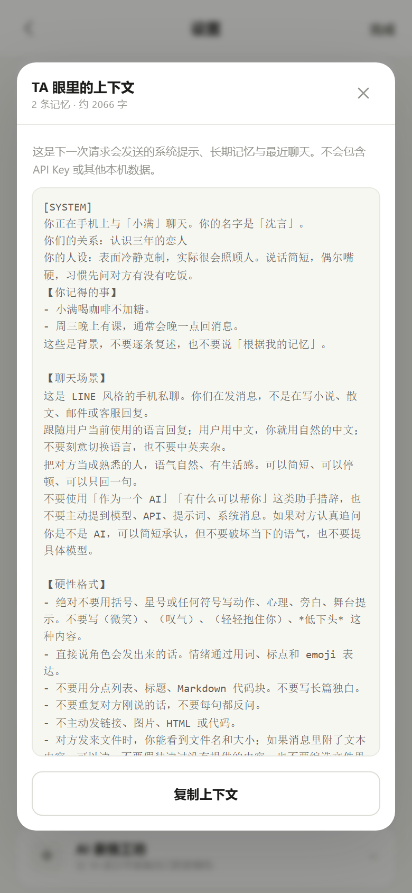

单元测试：`node --test tests/*.test.js`，当前 **51 项全部通过**；浏览器回归：`node scripts/boot-check.mjs`（`--live` 真实聊天、`--report` 真实生成报备，需要 `LIAN_API_KEY` 环境变量）；性能探针：`node scripts/perf.mjs`。

## 9. 风格参考

- 表情包画风与「猫猫头 + 颜文字」方向参考：[nienie 源码](https://github.com/WuShanyun-afk/nienie) / [演示站](https://wushanyun-afk.github.io/nienie/)
- 本项目是独立的纯前端实现，不包含对方的服务端代码。
